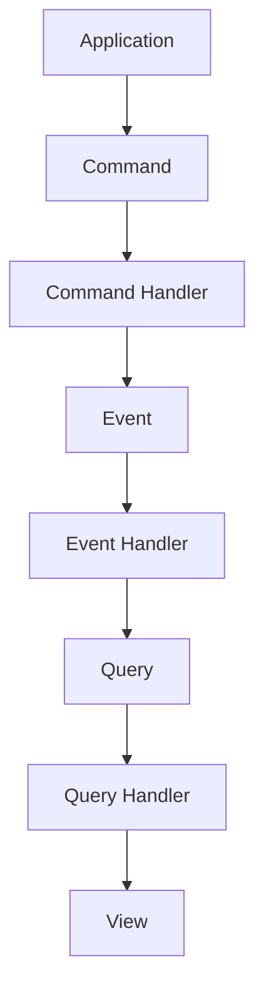

# accounting-pattern

Implementation of Martin Fowler's [Accounting Patterns article](http://martinfowler.com/apsupp/accounting.pdf) and [Accounting Narrative](http://martinfowler.com/eaaDev/AccountingNarrative.html).

## Requirements

- JDK 26
- Maven

## Build and Test

Run the following command to build the project and execute the verification tests:

```bash
mvn verify
```

## Summary

The accounting pattern manages financial transactions and supports accurate financial reporting.

Key concepts:

- **Transaction:** Represents a financial event.
- **Entry:** Records an amount and its accounting entry type.
- **Account:** Represents an account where entries are recorded.
- **Ledger:** Tracks accounting entries.

The pattern helps maintain accurate financial records.

## Pattern


